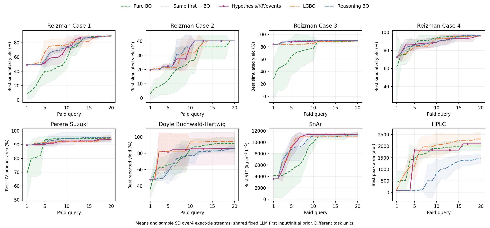

# Evidence for inconsistent incremental value of later knowledge decisions

> GitHub edition: metric/contrast summaries and derived cumulative-best curves are published; original observations, selected-condition histories, LLM packets and native logs remain local. [Evidence boundary](../LOCAL_DATA_REQUIREMENTS.md).

The research question is whether feedback on the knowledge used to select an experiment improves the next decision and the ensuing trajectory. Separate an informative starting experiment, a changed knowledge state, a changed action and a useful action. The supplied outcomes include gains, ties and losses.

## Principal comparisons

| Cohort | Evidence | Result and qualification |
|---|---|---|
| Historical 4+16 | [131 metric rows](cohorts/warm_4plus16/metrics.csv), [derived running-best curves](cohorts/warm_4plus16/running_best.csv) | V13 vs BO 17/0/15 SearchAUC W/T/L; vs RBO 11/7/14 over 32 cells. The additional three API V12 rows remain identified. |
| Original V13 0+20 | [96 metric rows](cohorts/v13_cold_0plus20/metrics.csv), [derived running-best curves](cohorts/v13_cold_0plus20/running_best.csv) | V13 vs BO 22/1/9 and vs RBO 13/5/14. Initialization and later policy effects are combined here. |
| Shared-prefix V13 ablation | [75 continuation/transfer rows](cohorts/v13_late_and_transfer/final_metrics.csv), [30 contrasts](cohorts/v13_late_and_transfer/conditional_effects.csv) | Across six fixed prefixes, full V13 has no positive mean continuation-AUC increment over fixed KF or disabled future refresh. Responses differ across arms. |
| Programmatic KF pilot | [Metrics](kf_weight/metrics.csv), [derived running-best curves](kf_weight/running_best.csv) | Dynamic-minus-fixed AUC is 0 in Perera seed2 and +33.45 in HPLC seed3. |
| Programmatic KF confirmation | [Metrics](kf_confirmation/metrics.csv), [paired effects](kf_confirmation/paired_effects.csv), [first divergences](kf_confirmation/first_divergences.csv) | Relative AUC: 0.00% Perera, +2.21% HPLC, -0.37% Direct Arylation; the registered cross-task gate was unmet. |
| Latest grounded comparison | [Complete tables with SD](grounded_baselines_20261105/comparison_tables.txt), [160 per-stream rows](grounded_baselines_20261105/per_seed_results.csv), [3200 derived running-best positions](grounded_baselines_20261105/running_best.csv) | Current controller exceeds BO in 6/8 task means; the same-first comparison is 8/16/8 over 32 cells. |

All primary records appear in [combined_primary_metrics.csv](combined_primary_metrics.csv), with original states and hashes. Reference trajectories are reused. The index has 487 comparison rows and 464 distinct linked state-file artifacts; neither number alone counts independent new experiments.

## Latest four-stream results

Each entry is **mean SearchAUC / mean final best**, in the task's native unit. Means and sample SD are available separately in the complete tables. These exact-tie streams share fixed initial LLM knowledge/first proposal and GP numerical seed0. Rounding does not define metric ties.

| Task | Current hypotheses/KF/events | LGBO | Reasoning BO | Pure BO | Same first + BO |
|---|---:|---:|---:|---:|---:|
| Reizman Case1 | 71.35 / 89.57 | 74.74 / 89.03 | 72.30 / 89.30 | 59.70 / 89.30 | 72.62 / 89.30 |
| Reizman Case2 | 32.27 / 40.09 | 31.34 / 40.09 | 33.02 / 40.09 | 25.29 / 40.09 | 32.16 / 40.09 |
| Reizman Case3 | 88.63 / 90.18 | 86.68 / 89.51 | 89.29 / 90.38 | 74.71 / 89.32 | 88.63 / 90.18 |
| Reizman Case4 | 89.11 / 95.92 | 88.61 / 96.01 | 89.23 / 96.23 | 89.71 / 95.92 | 89.07 / 96.08 |
| Perera | 91.98 / 93.91 | 92.21 / 94.92 | 93.49 / 95.12 | 91.04 / 94.93 | 92.47 / 94.53 |
| Doyle | 80.92 / 85.68 | 85.39 / 94.44 | 72.26 / 85.40 | 78.15 / 92.21 | 73.37 / 86.08 |
| SnAr | 9854.69 / 11404.28 | 9665.05 / 10938.30 | 9570.13 / 11093.62 | 8571.71 / 11404.28 | 9854.07 / 11391.85 |
| HPLC | 1548.38 / 2097.94 | 1779.94 / 2308.19 | 769.13 / 1448.63 | 1645.81 / 2004.27 | 1548.38 / 2097.94 |

The plot shows means and descriptive sample SD, with separate task units/scales. The study combines 552 preserved subagent and 664 later API responses. It does not independently resample initial knowledge. All unfavourable tasks remain in the comparison. LGBO/RBO use documented matched adapters; query budgets match while LLM computation differs from the event-driven controller.

The current controller has 23/0/9 SearchAUC W/T/L against BO but 8/16/8 against same-first BO. Its final-best W/T/L against BO is 10/11/11. Early running-best gains do not imply a consistent terminal-best gain or establish a causal KF benefit.

## Mechanism evidence and earlier development

[Coverage/visibility tables](cohorts/v13_late_and_transfer/candidate_coverage_summary.csv) and [KF calculations (local evidence)](../LOCAL_DATA_REQUIREMENTS.md) distinguish state updates from opportunities to affect selection. [Initialization/continuation accounting](grounded_baselines_20261105/paired_start_and_continuation_differences.csv) gives the within-cell identity `(method-BO)=(same-first BO-BO)+(method-same-first BO)`; it is an accounting decomposition rather than a module intervention.

Earlier first-point sensitivity, recursive-path, qLogEI rollout, event-refresh and fitting audits remain in their existing result folders. Their full native records are in the [archive catalogue](../data_catalogue/archive_catalogue.csv). No early development group was discarded based on performance. Partial/failed execution statuses and raw diagnoses are retained.

Read [METRICS_AND_COHORTS.md](../docs/METRICS_AND_COHORTS.md) for denominators, units, knowledge conditions, backend distinctions and overlap rules. Perera uses UV chromatographic product area percent; Direct Arylation uses yield; HPLC uses source peak area; SnAr uses space-time yield. Raw objectives are not averaged across tasks.
